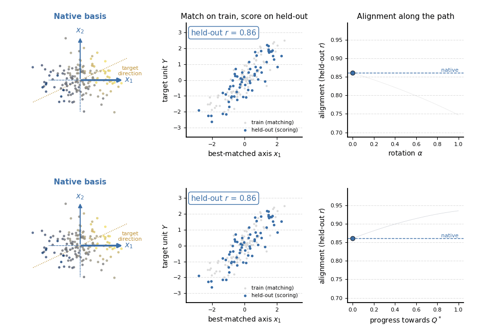
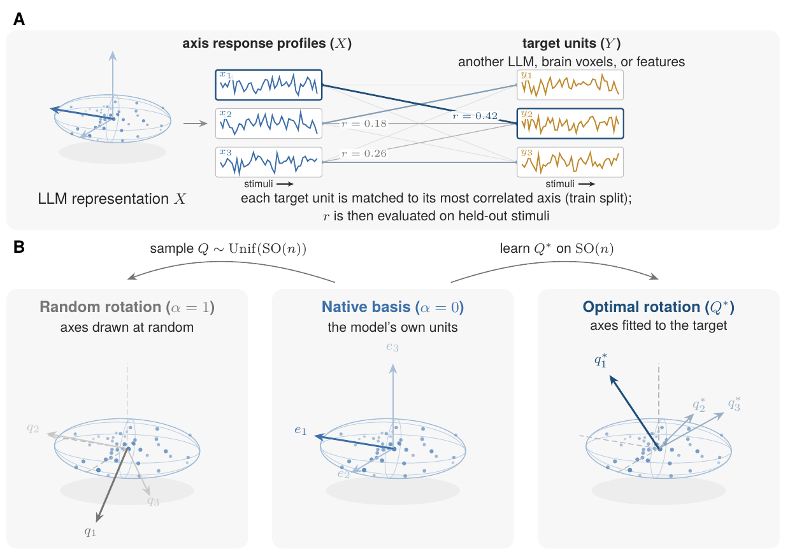
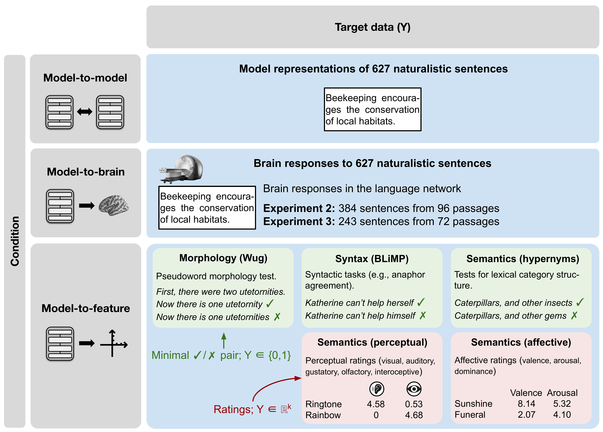
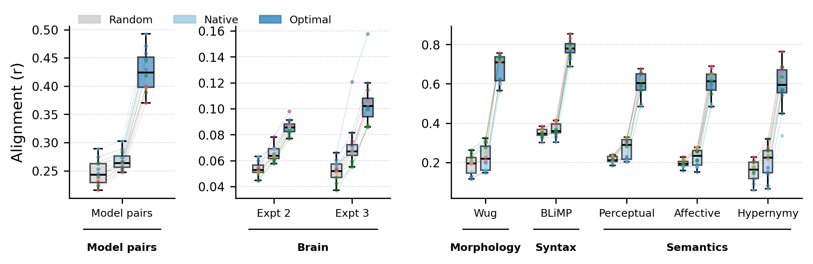
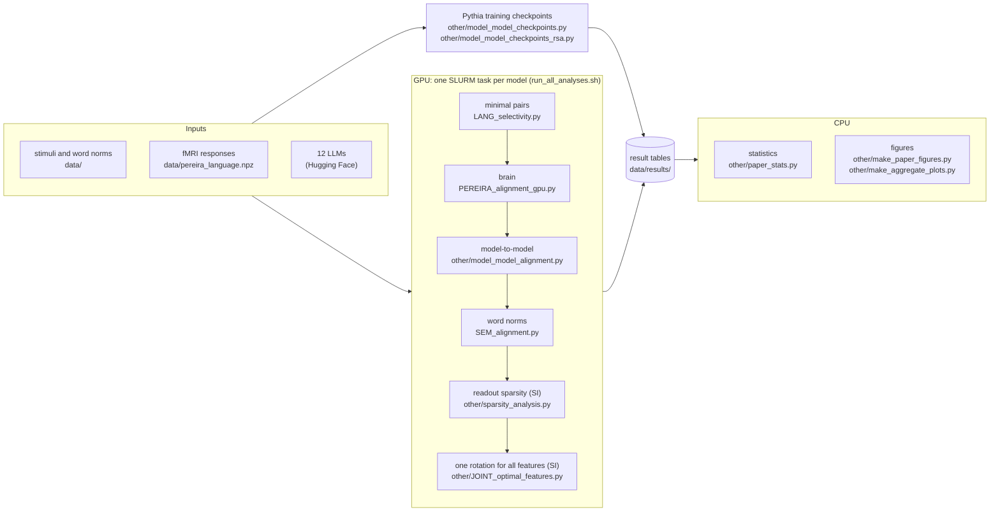

# Partially canonical axes in large language model representations

Code and results for de Varda, D'Elia, Tuckute, Fedorenko & Khosla, *Partially canonical axes in large language model representations*.

LLM hidden states are usually treated as points in a space and the traditional view is that the coordinate axes are not meaningful: what matters are directions in space, and distances between representations. One prediction following this view is that you can rotate the coordinate system and nothing of substance should change. Here, we test this prediction. We take a target Y (a unit of another LLM, a voxel in the human language network, or an interpretable linguistic feature, such as concreteness), match it to the single LLM unit it correlates with best, and ask how that match changes when the LLM axes are rotated. Across 12 models from six families, the model's own axes predict the various targets better than randomly rotated axes do, but much worse than axes rotated to fit the target. LLM coordinates are partially canonical: not arbitrary, but not fully canonical either.

<p align="center"></p>
<p align="center"><sub>Toy example in 2D (not data from the paper!). Top: applying random rotations to the native axes lowers the held-out correlation between the target and its best-matched axis. Bottom: rotating them towards the target increases the held-out correlation.</sub></p>

## Method

<p align="center"></p>

Each target unit is paired with the LLM axis it correlates with most strongly (in absolute value) on a training split, and the pair is then scored on held-out stimuli. We average this score over target units and layers, and compute it three times: in the model's native basis, after random rotations of increasing size ($Q^\alpha$, from $\alpha = 0$, no rotation, to $\alpha = 1$, a fully random rotation), and after a rotation $Q^*$ learned to maximise the score. If the native axes were arbitrary, native and random would score the same; if they were fully canonical, native and optimal would.

## Three alignment targets

<p align="center"></p>

| Setting | $X$ | $Y$ | Stimuli |
|---|---|---|---|
| Model-to-model | each of 11 LLMs + a second Pythia-160M seed | Pythia-160M (both directions, 4 depth-matched layers) | 627 Pereira sentences |
| Model-to-brain | each of 12 LLMs | fMRI, language network, 273 most reliable voxels per participant | same 627 sentences, passage-level 10-fold CV |
| Model-to-feature | each of 12 LLMs | Wug (morphology), 12 BLiMP sub-tasks (syntax), hypernymy, perceptual and affective norms | 998 + 12,000 + 551 minimal pairs; 13,372 words |

Models: GPT-2 (124M, 355M, 774M, 1.5B), LLaMA-3.2 (1B, 3B), Gemma-3 (1B), Mamba (130M, 370M, 790M), Qwen-3 (0.6B), Pythia (160M). We also test whether linear readouts of the features are sparser in the native basis, and track how the native-over-random advantage develops during training (Pythia checkpoints, 14M–410M).

<p align="center"></p>

## Code



The matching and rotation code is in `privileged_axes/` (adapted from Khosla et al., 2024). `run_all_analyses.sh` submits all GPU analyses to SLURM.

## Reproducing the statistics and figures (CPU, it only takes a few minutes)

The result tables behind the paper are included in `data/results/`, so no GPU is needed for this step.

```bash
conda env create -f environment.yml && conda activate basis-alignment
python other/paper_stats.py                         # data/results/stats/paper_stats.md (+ CSVs)
PEREIRA_VOXSET=all python other/paper_stats.py      # SI: all language voxels -> data/results/stats_voxavg_all/
python other/make_aggregate_plots.py                # plots/summary/ (Fig. 3 = native_vs_optimal_three.png)
python other/make_paper_figures.py                  # plots/paper/Fig1, Fig2, Fig4, FigS1, FigS2 + Table S1
```

Every statistic reported in the paper ends up in `data/results/stats/paper_stats.md`.

## Rerunning the analyses (GPU cluster with SLURM)

1. **Data.** `scripts/fetch_brain_data.sh` downloads `pereira_language.npz` into `data/` (see [Brain data](#brain-data)); the brain step reads the fMRI responses and the model-to-model and Pythia-checkpoint steps read the Pereira sentences from it. Affective norms: `scripts/fetch_warriner.sh`. Everything else is in `data/`.
2. **Environment.** `cp pipeline/env_setup.example.sh pipeline/env_setup.sh` and edit it to activate the environment on your cluster. A Hugging Face token is required (`export HF_TOKEN=...` or `huggingface-cli login`; LLaMA and Gemma are gated). Point `HF_HOME` at a dedicated directory: after each model's analyses finish, the pipeline deletes its activations and its weights from `$HF_HOME/hub` (disable with `--no-cleanup`).
3. **Run.**
   ```bash
   ./run_all_analyses.sh --dry-run                                   # show the sbatch calls
   ./run_all_analyses.sh --max-gpus 6 --sbatch-args "-p <partition>"  # 22-task array, <= 6 GPUs at once
   ```
   The array (`pipeline/stage_all.txt`) has 22 tasks: 12 per-model tasks, each running one model through all analyses (LANG → Pereira → model-to-model → SEM → sparsity → joint), and 10 Pythia training-checkpoint tasks (5 alignment + 5 RSA). Every step checkpoints and resumes; `--steps LANG,MM,...` reruns a subset of the per-model steps. The paper's runs used one A100 80GB per task (≈1–2 days for the largest models). Then run the CPU stage above.
4. **Tests.** `python -m pytest other/test_core.py other/test_pereira_data.py -q`, then `python other/test_pereira_targets.py`, `python other/test_readout_sparsity_plots.py` and `python other/test_pooling.py` (the last downloads the GPT-2 and Pythia-160M tokenizers and GPT-2 weights from Hugging Face). Tests that need `data/affective.csv` or the brain data are skipped when those files are absent.

## Brain data

The fMRI responses are those of Pereira et al. (2018), Experiments 2 and 3: per-session GLM effect sizes for every sentence in the 1,364 voxels of each participant's language network.

`data/pereira_language.npz` (70 MB) contains these responses in the form the code reads (`pereira_data.load_pereira()`). Download it with `scripts/fetch_brain_data.sh` (asset of the [v1.0 release](https://github.com/Andrea-de-Varda/partially-canonical-axes/releases/tag/v1.0)). sha256 `d7a2f3649d59544effde6fc334945b4bd906b9a0e8ce853eca34185033d1a7ae`. If you use these data, please cite Pereira et al. (2018).

## Third-party data

The stimuli and norms come from the papers below and keep their original licenses (details in `data/README.md`). **If you use any of them, please cite the original paper.**

| Data | Source | License |
|---|---|---|
| BLiMP (12 sub-tasks) | Warstadt et al. (2020), TACL | CC BY 4.0 |
| Wug minimal pairs | Hanna, Belinkov & Pezzelle (2026), *Computational Linguistics* | MIT (`data/language_data/LICENSE-hanna`) |
| Hypernymy minimal pairs | adapted from Hanna & Mareček (2021); files from Hanna et al. (2026) | MIT |
| Lancaster Sensorimotor Norms | Lynott et al. (2020), *Behavior Research Methods* | CC BY 4.0 |
| Valence/arousal/dominance norms | Warriner, Kuperman & Brysbaert (2013), *Behavior Research Methods* | not redistributed; `scripts/fetch_warriner.sh` downloads the original |
| Pereira sentences and fMRI | Pereira et al. (2018), *Nature Communications* | see [Brain data](#brain-data) |

## Citation

```bibtex
@article{devarda2026partially,
  title   = {Partially canonical axes in large language model representations},
  author  = {de Varda, Andrea Gregor and D'Elia, Ferdinando and Tuckute, Greta and Fedorenko, Evelina and Khosla, Meenakshi},
  year    = {2026}
}
```

The matching and rotation code in `privileged_axes/` is adapted from Khosla, Williams, McDermott & Kanwisher (2024), *Privileged representational axes in biological and artificial neural networks*, bioRxiv (doi:10.1101/2024.06.20.599957); please cite it too.

## License

Code: MIT (`LICENSE`). Data: see above.
